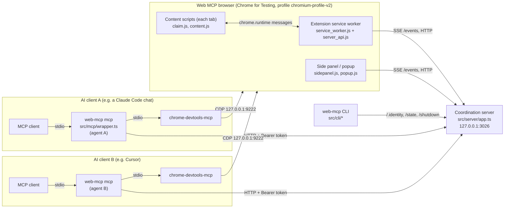
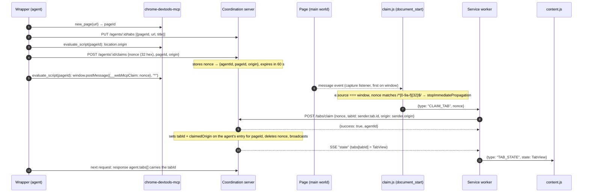

# Architecture

This page is for people working on Web MCP itself. It describes 0.2.0 (HTTP protocol version 2). The source files named here are the source of truth. If this page disagrees with them, the code wins (and please fix the page).

## Components



| Component | Source | Role |
|-----------|--------|------|
| Wrapper (`web-mcp mcp`) | `src/mcp/wrapper.ts` | MCP stdio server. One process per AI client process, which makes it **one agent**. It registers with the coordination server, starts its own `chrome-devtools-mcp` child, calls its tools with the agent's own `pageId`, and rewrites every result so other tabs never show up (`scopeResult`). |
| `chrome-devtools-mcp` | dependency (`1.12.0`) | Drives the browser over CDP. Started from Web MCP's own `node_modules` with `--browserUrl=http://127.0.0.1:<chrome.port> --no-usage-statistics --no-performance-crux --redactNetworkHeaders --no-file-navigations --experimentalStructuredContent`, plus one `--blockedUrlPattern=` per entry: the DevTools port on `127.0.0.1`, `localhost` and `0.0.0.0`, then the user's `security.blockedUrlPatterns`. Environment: `CHROME_DEVTOOLS_MCP_NO_USAGE_STATISTICS=1`, `CHROME_DEVTOOLS_MCP_NO_UPDATE_CHECKS=1`. Its stderr is captured, so startup errors reach the user. |
| Coordination server | `src/server/app.ts` (routes, state), `server.ts` (process), `logger.ts` | Detached Node process on `127.0.0.1:<server.port>`. Holds agents, tombstones, tabs, pending claims, halts and the log buffer **in memory**. It writes only redacted logs and recordings to disk. |
| Shared code | `src/shared/paths.ts`, `protocol.ts`, `launcher.ts` | Paths, config validation, token, `PROTOCOL_VERSION`, payload types. The launcher is the **only** code that starts the server or the browser, and it owns the scoped process kills and the helper registry. |
| Extension | `src/extension/` (built into `extension/`) | Manifest V3. `claim.js` (`document_start`) relays tab claims. `content.js` (`document_end`) renders the overlay and badge. The service worker holds the token and is the only extension context that talks to the server on behalf of content scripts. The side panel and popup show agents and send Halt/Resume. `server_api.js` is the shared, identity-checking server client for the privileged contexts. |
| CLI | `bin/web-mcp.js`, `src/cli/*.ts` | `setup`, `uninstall`, `test`, `status`, `stop`, `troubleshoot`, `browser`, `install-browser`, and the interactive menu. Exit codes: 0 ok, 1 failed, 2 usage error. |

## Process lifecycle

1. The AI client starts `npx -y @amitnarw/web-mcp@<version> mcp`. `bin/web-mcp.js` loads `dist/mcp/wrapper.min.js`.
2. **Wrapper start** (`main()`):
   1. Loads and validates the config.
   2. Reads or creates the token.
   3. Deletes legacy 0.1.x files.
   4. Registers `browser_evaluate` only if `security.allowEvaluate`.
   5. Connects stdio.
   6. Starts the 15-second heartbeat (`heartbeat()`):
      - 200: adopt the returned agent.
      - 404: register again.
      - Unreachable: restart the server with `ensureServer` and register again, so the extension's 60-second zombie check never fires while a chat is open.
3. **First browser tool call** (`ensureReady()`):
   1. `ensureServer`. It sends `GET /.identity?challenge=<random>` and accepts a server only if its `protocol` matches and its `proof` equals `HMAC-SHA256(token, challenge)`. If no Web MCP server answers, it spawns `dist/server/server.min.js` detached and polls `/.identity` until `server.startupTimeout`. Anything else on the port is an error; nothing gets killed.
   2. `POST /agents` with the MCP client's `clientInfo` name and version, `WEB_MCP_AGENT_NAME` if set, and `previousAgentId` if this wrapper had an agent before.
   3. `ensureChrome`. If CDP answers and *our* extension's service worker is present (matched by its exact unpacked-extension id, see [Launcher details](#launcher-details)), it uses that browser. Otherwise, under the [launch lock](#launch-lock), it:
      - kills browser processes with exactly the Web MCP `--user-data-dir`,
      - refreshes `~/.web-mcp/extension` if the source files changed, and writes `env.js` with the port and token (mode 600),
      - seeds Developer Mode in `Local State`,
      - spawns the browser,
      - waits for the CDP port and the extension's service worker.
   4. Spawns `chrome-devtools-mcp` and connects to it (3 attempts). Each helper PID is recorded in `~/.web-mcp/helpers/<pid>.json`.
4. **Each tool call** goes through a per-agent serial queue (`serial()`), then `act()`:
   1. `POST /agents/:id/actions` (423 means halted, 404 means register again). For typed input, the wrapper first announces silently, checks whether the target field looks secret (`isSecretField`), then announces the real or the redacted text.
   2. Try to claim the current tab if it isn't linked yet.
   3. Set `data-bp-ai-acting` on `<html>` for input actions (see [acting flag](#the-acting-flag)).
   4. Call `chrome-devtools-mcp`. Web MCP's own helper scripts go through `pageEval` (`waitForStableDom: false`, `dialogAction: "dismiss"`).
   5. Scope the result. Pages listed under `openedPages` (pop-ups the agent's page opened) are adopted as the agent's tabs and claimed.
   6. Clear the attribute about 100 ms later (in `finally`). After a hover it stays at `mouse` until the next state-changing action.
5. **Browser gone.** A `chrome-devtools-mcp` result saying it can't connect to Chrome, or a `reconnected` flag, resets the agent's pages and tells the AI its tabs are gone. The next call relaunches the browser.
6. **Wrapper exit** (stdin closes, SIGINT or SIGTERM): `DELETE /agents/:id`, close `chrome-devtools-mcp` and unregister its helper record. The server and the browser are shared, so the wrapper never kills them. The agent's tabs stay open.
7. **Server sweep**, every 5 s:
   - An active agent with no activity for `agents.idleTimeoutMs` becomes idle.
   - An agent with no request for `agents.staleAfterMs` (at least 45 s) is removed.
   - Expired claims and tombstones are dropped.
   - **Clock-jump guard:** if the time since the last sweep is negative or more than three sweep intervals (laptop sleep, debugger pause, clock change), every agent's timers are restarted instead of reaping anyone.

   Removing an agent writes its recording and leaves a tombstone (see [Agents](#one-wrapper--one-agent)). On SIGINT, SIGTERM or `POST /shutdown`, the server removes every agent (writing their recordings) and deletes its PID file. It has no idle shutdown: it runs until stopped or a crash.
8. **Extension service worker**:
   - Verifies the server's identity, then keeps an SSE connection to `/events?token=…` and pushes each tab its view.
   - Pings `/ping` every 3 s. After the first successful ping, 20 consecutive failures (about 60 s) make it close every browser window, so an orphaned browser doesn't linger.
   - If the server has been unreachable for 15 s, it clears all tab views, which removes the overlays.

## One wrapper = one agent

An agent is created by `POST /agents` and identified by 8 random hex characters.

- **Label:** `label` from the request (for example from `WEB_MCP_AGENT_NAME`), or a pretty client name plus a per-name counter (`Claude Code #1`). The `clientInfo.name` to label mapping matches exactly or as a `<name>-…` prefix: `claude-code` → Claude Code, `claude-ai` → Claude Desktop, `cursor` → Cursor, `opencode` → OpenCode, `codex-mcp-client` / `codex` → Codex, `windsurf` → Windsurf, `zed` → Zed, `cline` → Cline. Any other name is shown raw, and an empty name becomes `Agent`.
- **Color:** the first of `#4b8eff #34c759 #ff9f0a #bf5af2 #ff375f #64d2ff #ffd60a #ac8e68` not in use, or `colors[agentCount % 8]` when all are taken.
- **Status:** `idle` or `active`, plus a separate sticky `halted` flag. `POST /actions` sets `active`. `PATCH {status:"idle"}` (from `browser_done`) and the idle sweep set `idle`. A halted agent stays `idle`, and `PATCH {status:"active"}` is ignored while it is halted.
- **Tabs:** `{pageId, tabId, url, title}` plus `currentPageId`, and a server-private `claimedOrigin`. The wrapper replaces the whole list with `PUT /agents/:id/tabs` whenever it changes.
- **Limit:** at most 64 live agents (`429 too_many_agents`).
- **Tombstones and re-registration.** When an agent is removed, the server keeps a tombstone (id, label, color, client, task, halted) for 30 minutes, at most 200 of them. A wrapper that registers again sends `previousAgentId`:
  - If that agent is still live, the server returns it (200).
  - If a tombstone exists, the agent is restored with the same id, look and **halt state** (201).
  - Otherwise it gets a new id. If the wrapper's last known state was halted, it immediately calls `POST /agents/:id/halt` again, so a server restart can't lift a halt.
- **`browser_stop`** first makes a silent `POST /actions` (so a halted agent gets 423 and is refused), then closes its pages and `DELETE`s the agent.

## `pageId` vs Chrome tab id

There are two id spaces:

| Id | Assigned by | Scope | Known to |
|----|-------------|-------|----------|
| `pageId` | `chrome-devtools-mcp` | **Per wrapper process.** Each agent has its own `chrome-devtools-mcp`, so two agents can both have page `2`. | The wrapper (and the AI, as "tabId" in tool parameters) |
| `tabId` | Chrome (`chrome.tabs`) | Global for the browser | The extension |

The server links them per agent. The overlay needs the Chrome tab id (a content script only knows its own `sender.tab.id`), while the wrapper only knows `pageId`. `StatePayload.tabs` is keyed by Chrome tab id and only contains tabs whose `tabId` is known.

### Linking a page to its Chrome tab

The two ids are linked with a single-use, origin-bound nonce:



Rules:

- The service worker always uses `sender.tab.id` and `sender.origin` from a top-frame sender, never values from the message.
- `POST /tabs/claim` errors:
  - 404 `unknown_claim`: unknown or expired nonce.
  - 409 `origin_mismatch`: the origin differs from the one the wrapper registered. The claim stays pending.
  - 409 `tab_owned`: another agent owns that Chrome tab.
  - 409 `too_many_tabs`: the agent already has 500 tabs.

  If the wrapper hasn't `PUT` the page yet, the server creates the entry.
- `claim.js` runs at `document_start`, so its capture listener is the first one on `window`. It consumes valid claim messages before page scripts see them, and forwards at most 10 per 10 seconds.
- **The server is the only source of tab ids.** `PUT /agents/:id/tabs` ignores any `tabId` the wrapper sends. Each page keeps the id the server learned through `/tabs/claim`, or none. If a page's URL now has a different origin than the one it was claimed from, its tab id is dropped, and the wrapper (which notices the id disappear in `adoptAgent`) claims it again.
- `PUT` drops tabs whose `tabId` would belong to another agent and lists them in `conflicts` (a safety net; claims already check ownership).
- The wrapper only claims `http(s)` pages (content scripts don't run on `about:` or `data:` pages). It never claims isolated pages, and makes at most 8 attempts per page (reset when the page loses its tab id).
- When a tab closes, the service worker calls `POST /tabs/:tabId/closed`.

### The acting flag

The content script blocks trusted human input on an active agent's tabs with capture listeners on `window`: clicks, aux clicks, context menus, pointer, touch, wheel and key events. The overlay also covers the page (in the top layer via `popover="manual"`), and is re-attached if the page removes it. The wrapper lets its own CDP input through by setting `data-bp-ai-acting` on `<html>`:

| Value | Set for | Effect |
|-------|---------|--------|
| `mouse` | click, hover, drag | Pointer events pass, and Web MCP's UI becomes pointer-transparent. Keys are blocked. |
| `true` | type, keypress, fill, select | Everything passes. That includes the trusted click that Enter produces on a form, button or link. |
| `capture` | screenshot | Like `mouse`, and Web MCP's UI is invisible. |
| `keyboard` | (not set by 0.2.0's wrapper) | Keys and keyboard-generated clicks pass. |

The flag is set with a forced layout flush and two animation frames, and is removed about 100 ms after the action (in `finally`), so trailing key-up events pass. After `browser_hover`, `mouse` lingers until the next action that isn't a snapshot, screenshot, wait or URL read, so hover menus stay open. `browser_done` clears it.

## HTTP API

Base URL `http://127.0.0.1:<server.port>`. JSON in and out. Types are in `src/shared/protocol.ts`.

Every request first passes these checks, in order:

1. `Host` must be `127.0.0.1:<port>` or `localhost:<port>`. Otherwise **403** `forbidden_host`.
2. If an `Origin` header is present, it must start with `chrome-extension://`. Otherwise **403** `forbidden_origin`. `OPTIONS` gets **204** for extension origins and **403** for everything else. No `Access-Control-*` header is ever sent.
3. All routes except `GET`/`HEAD` `/.identity` and `/ping` need `Authorization: Bearer <token>`. `GET /events` may pass `?token=<token>` instead, because `EventSource` can't set headers. Otherwise **401** `unauthorized`.
4. `POST`, `PUT` and `PATCH` with a body must be `application/json`. Otherwise **415** `unsupported_media_type`. Bodies are limited to 1 MB (**413** `payload_too_large`). Malformed JSON gets **400** `invalid_json`.

Errors look like `{"error": "<code>"}`, or `{"error": "invalid_body", "detail": "…"}` for validation failures.

**Clients must verify the server before sending the token.** Call `GET /.identity?challenge=<64 lowercase hex>` and compare `proof` with `hex(HMAC-SHA256(token, challenge))` in constant time. The launcher (`getServerIdentity`), the CLI (`status`, `stop`) and the extension (`server_api.js`) all do this.

| Method and path | Auth | Body | Response | Used by |
|-----------------|------|------|----------|---------|
| `GET /.identity[?challenge=]` | no | — | `{identity: "web-mcp-server", version, protocol: 2, pid, proof?}`. `proof` only with a valid 64-hex `challenge` | launcher, CLI, extension |
| `GET /ping` | no | — | `{status: "ok"}` | service worker (liveness) |
| `POST /shutdown` | yes | — | **202** `{success: true}`. Then the server closes (writing recordings) and exits | `web-mcp stop` |
| `POST /agents` | yes | `{clientName?, clientVersion?, label?, previousAgentId?: 8 hex}` | **201** `{agent}` (new or restored), **200** `{agent}` if `previousAgentId` is live, **429** `too_many_agents` | wrapper |
| `GET /agents/:id` | yes | — | `{agent}`, or 404 `unknown_agent` | — |
| `PATCH /agents/:id` | yes | `{label?, taskName?, status?: "active" \| "idle"}` | `{agent}` | wrapper (`browser_start`, `browser_done`) |
| `POST /agents/:id/heartbeat` | yes | — | `{agent}` (updates `lastSeen`) | wrapper, every 15 s |
| `DELETE /agents/:id` | yes | — | `{success: true}`. Writes the recording, leaves a tombstone | wrapper (exit, `browser_stop`) |
| `PUT /agents/:id/tabs` | yes | `{tabs: {pageId, url?, title?}[] (max 500), currentPageId: number \| null}`. `tabId` is ignored | `{agent, conflicts: number[]}` | wrapper |
| `POST /agents/:id/claims` | yes | `{nonce: 32 lowercase hex, pageId: int, origin?: string}` | `{success: true}`. 409 `claim_exists` if another agent registered that nonce. At most 100 pending claims per agent | wrapper |
| `POST /agents/:id/actions` | yes | `{text, type, redactedText?, silent?}` | `{agent}`, or **423** `{error: "halted", agent}` | wrapper, before every tool call |
| `POST /agents/:id/halt` | yes | — | `{agent}` (`halted: true`, `status: "idle"`) | side panel, wrapper (re-halt) |
| `POST /agents/:id/resume` | yes | — | `{agent}` (`halted: false`) | side panel |
| `POST /halt-all` | yes | — | `{success: true}` | side panel, popup |
| `POST /tabs/claim` | yes | `{nonce, tabId: int >= 0, origin?: string}` | `{success: true, agentId}`, or 404 `unknown_claim`, 409 `origin_mismatch` / `tab_owned` / `too_many_tabs` | service worker |
| `POST /tabs/:tabId/halt` | yes | — | `{agent}` (halts the owner), or 404 `unknown_tab` | service worker (overlay Halt) |
| `POST /tabs/:tabId/closed` | yes | — | `{success: true}` | service worker (`tabs.onRemoved`) |
| `GET /state` | yes | — | `StatePayload` | service worker, popup, `web-mcp status` |
| `GET /events` | yes (header or `?token=`) | — | SSE stream, see below. `HEAD` returns the headers only | service worker, side panel |
| `GET /logs?since=<ISO>` | yes | — | `{logs: [{timestamp, message}]}`: up to the last 200 entries, newer than `since` if given, already redacted | side panel, popup |

Notes:

- `POST /actions` sets `status: "active"` and updates `lastActionAt` and `lastSeen`. Unless `silent`, it appends `{text, type, timestamp}` to the agent's actions (50 kept in memory, the last 20 exposed in `AgentPublic.actions`, for the side panel only). It logs and records `redactedText ?? text`. The unredacted `text` is never written to disk, and no action text ever goes into `TabView`. `text` is required unless `silent`.
- The wrapper supplies `redactedText` for typed input (`Typing (N chars)`), option selection, and navigation (URL without query string or fragment). For fields that look secret it also sends the redacted form as `text`.
- Requests from the wrapper update `lastSeen`. Halt and resume come from the user, so they don't.
- String limits: `clientName`, `clientVersion`, `label` 100; `type` 40; `taskName` 300; `text` and `redactedText` 2000; tab `url` 4096; tab `title` 300; `origin` 300. Control characters are replaced with spaces.

### Types

```ts
interface AgentPublic {
  id: string; clientName: string; clientVersion: string;
  label: string; color: string; taskName: string;
  status: "idle" | "active"; halted: boolean;
  tabs: { pageId: number; tabId: number | null; url: string; title: string }[];
  currentPageId: number | null;
  actions: { text: string; type: string; timestamp: string }[]; // last 20, oldest first, raw text
  createdAt: string; lastActionAt: string | null;
}

interface TabView {           // what one tab's content script (and so the page) gets
  agentId: string; label: string; color: string;
  status: "idle" | "active"; halted: boolean;
  lastActionType: string | null; // e.g. "click"; null on non-current tabs
  current: boolean;              // tab.pageId === agent.currentPageId
}

interface StatePayload {
  version: string; protocol: number;
  agents: AgentPublic[];
  tabs: Record<string, TabView>; // keyed by Chrome tab id; only tabs with a known tabId
}
```

`TabView` is deliberately minimal: the page can read the overlay's DOM, so it gets no task name and no action text (which could contain other sites' URLs or typed text).

### SSE payload

`GET /events` sends one frame immediately, and another after every state change (changes are coalesced, about 30 ms debounce):

```text
event: state
data: {"version":"0.2.0","protocol":2,"agents":[…],"tabs":{"1234":{…}}}

```

It sends `: keepalive` comments every 15 s. Every frame is a full snapshot, so a client with more than 1 MB of unread data is simply dropped; `EventSource` reconnects on its own.

### Recordings

When an agent is removed (disconnect, `browser_stop`, stale sweep, server shutdown) and it has at least one non-silent action, the server writes `recordings/<ISO time with : and . replaced by ->-<agentId>.json` (mode 600):

```json
{
  "label": "Claude Code #1", "clientName": "claude-code", "clientVersion": "…",
  "createdAt": "…", "endedAt": "…",
  "actions": [{ "type": "type", "text": "Typing (12 chars)", "timestamp": "…" }]
}
```

At most 5000 actions are kept per recording. Only the newest `agents.maxRecordings` `*.json` files are kept.

## Extension messages

Content scripts → service worker (`chrome.runtime.sendMessage`). The service worker accepts only messages from its own extension and uses `sender.tab.id` (and `sender.origin` for claims) from the top frame.

| Message | From | Response | Effect |
|---------|------|----------|--------|
| `{type: "CLAIM_TAB", nonce}` | `claim.js` | `{success}` | `POST /tabs/claim {nonce, tabId: sender.tab.id, origin: sender.origin}` |
| `{type: "GET_TAB_STATE"}` | `content.js` | `{state: TabView \| null, boot, seq}` | The view for the sender's tab. Fetches `/state` first if the worker has none yet. |
| `{type: "HALT_TAB"}` | `content.js` | `{success, error?}` | `POST /tabs/<sender.tab.id>/halt` |
| `{type: "OPEN_SIDEBAR"}` | `content.js` | `{success, error?}` | `chrome.sidePanel.open({windowId: sender.tab.windowId})` |

Service worker → content script (`chrome.tabs.sendMessage`, frame 0):

| Message | When |
|---------|------|
| `{type: "TAB_STATE", state: TabView \| null, boot, seq}` | Only to tabs whose view changed, including the change to `null` when ownership or the agent goes away. On the worker's first state after a (re)start, it goes to every tab. |

`boot` identifies the service-worker lifetime and `seq` increases with every applied state. The content script drops replies older than a push it already applied. While a tab shows Web MCP UI, the content script also polls `GET_TAB_STATE` every 5 s, so a missed push can't leave a stale overlay.

Page main world → `claim.js`: `window.postMessage({__webMcpClaim: "<nonce>"}, "*")`, sent only by the wrapper through `evaluate_script`.

The side panel and popup are extension pages. They load `env.js` and `server_api.js`, verify the server's identity, and then call the HTTP API directly with the token. If verification fails they show why: token mismatch, another program on the port, no token, or not reachable. The manifest requests only the `sidePanel` permission and host access to `http://127.0.0.1/*`.

## `PROTOCOL_VERSION` rule

`PROTOCOL_VERSION` lives in `src/shared/paths.ts` (currently `2`) and is reported by `GET /.identity` and `StatePayload.protocol`.

- **Bump it on any incompatible change** to the HTTP contract between wrapper, server and extension: renamed or removed routes, changed body or response shapes, changed semantics.
- Wrappers refuse to use a server with a different protocol (`ensureServer`) instead of corrupting its state. `web-mcp status` shows a mismatch.
- Purely additive, backwards-compatible changes don't need a bump.

## Launch lock

Several AI clients often start at the same moment. Without coordination, each wrapper would re-copy the extension and kill the browser the other just launched. `ensureChrome` therefore:

1. Checks CDP and our extension worker without a lock. If both are fine, it is done.
2. Takes `~/.web-mcp/chrome-launch.lock`. It writes its PID to a private temp file and hard-links that into place, so the lock either fails or appears complete.
   - A lock whose owner PID is dead, or that is older than `chrome.startupTimeout + 20 s`, counts as stale and is removed.
   - Otherwise it polls every 250 ms, up to that same timeout, then fails with `Timed out waiting for another web-mcp process to finish launching Chromium`.
3. Inside the lock, checks CDP again and waits up to 5 s for an extension worker (another process may have just launched the browser), and only then launches.
4. Releases the lock only if it still contains its own PID.

The server has no lock. Before listening, it checks that nothing answers on `127.0.0.1:<port>` (on Windows a `0.0.0.0` listener doesn't make the bind fail). Racing wrappers may each spawn a server. The loser exits, and everyone talks to the winner. The PID file is written only after a successful `listen`, and removed only if it still holds the server's own PID. The token file is created the same way as the lock (temp file plus hard link), so racing processes never read a half-written token.

## Launcher details

- **Finding the browser** (`findChromePath`). If `chrome.executable` isn't `auto-detect`, that file is used. Otherwise:
  1. The Chrome for Testing build pinned by `puppeteer-core`'s revisions, computed with `@puppeteer/browsers` in `~/.cache/puppeteer`.
  2. The newest other Chrome for Testing build in that cache.
  3. A system Chromium.

  The `puppeteer` package itself is never imported at runtime, because it would read `.puppeteerrc`/`package.json` config from the AI client's working directory. `web-mcp install-browser` downloads the pinned build (`installChromeForTesting`).
- **Recognising our extension** (`hasExtensionWorker`). Chromium derives an unpacked extension's id from the SHA-256 of its absolute path: UTF-16LE with an upper-case drive letter on Windows, UTF-8 elsewhere. The first 32 hex digits are mapped `0-f` → `a-p`. The launcher computes that id for `~/.web-mcp/extension` (and its real path) and only accepts a `service_worker.js` target with that id.
- **Refreshing the extension copy** (`prepareExtension`). A signature of the package version plus the name, size and mtime of every source file (except `env.js`) is stored in `extension/.web-mcp-source`. When it differs, the copy is replaced. This only happens at browser launch.

## Process-kill scope

| Function | Kills | Used by |
|----------|-------|---------|
| `killProfileChrome(profileDir)` | Processes whose command line contains exactly `--user-data-dir=<profileDir>`. Windows: CIM query plus `Stop-Process`, with the path passed through an environment variable. Elsewhere: `pkill -f` with an escaped, anchored pattern. | launcher (before launch), `stop`, `troubleshoot` |
| `killStaleChromeDevtoolsMcp(port)` | Only helpers recorded in `<home>/helpers/*.json` for that CDP port, and only if the recorded PID's command line still contains `chrome-devtools-mcp` and `--browserUrl=http://127.0.0.1:<port>`. Records are removed. | `stop`, `troubleshoot` |
| `stopCoordinationServer(port)` | 1. Authenticated `POST /shutdown`, only to a server that passed the identity proof. 2. Otherwise SIGTERM (then SIGKILL on POSIX) to the PID in `server.pid`, only if `/.identity` reports that PID. For a 0.1.x server (no PID, no protocol) or an unverified one, the PID must also be listening on the port and have a Web MCP-server-like command line. Otherwise the command reports `skipped` and exits with code 1. | `stop`, `troubleshoot`, `uninstall all` |

Nothing kills by port owner or by broad name patterns.
